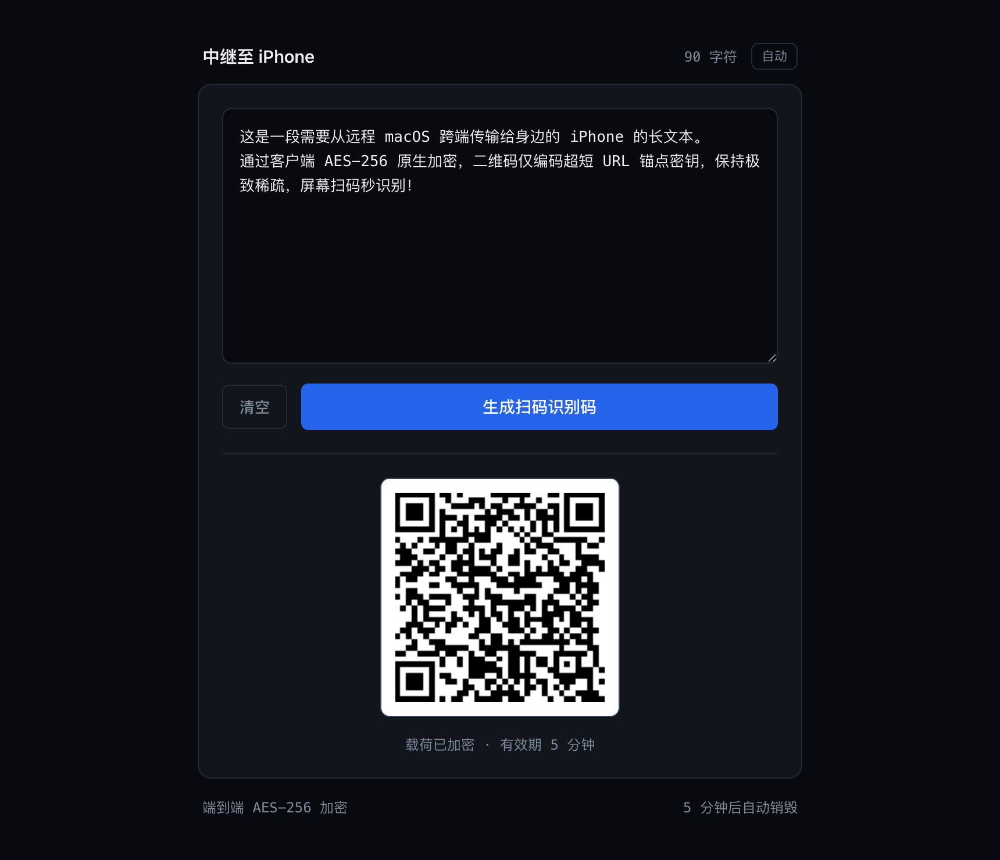
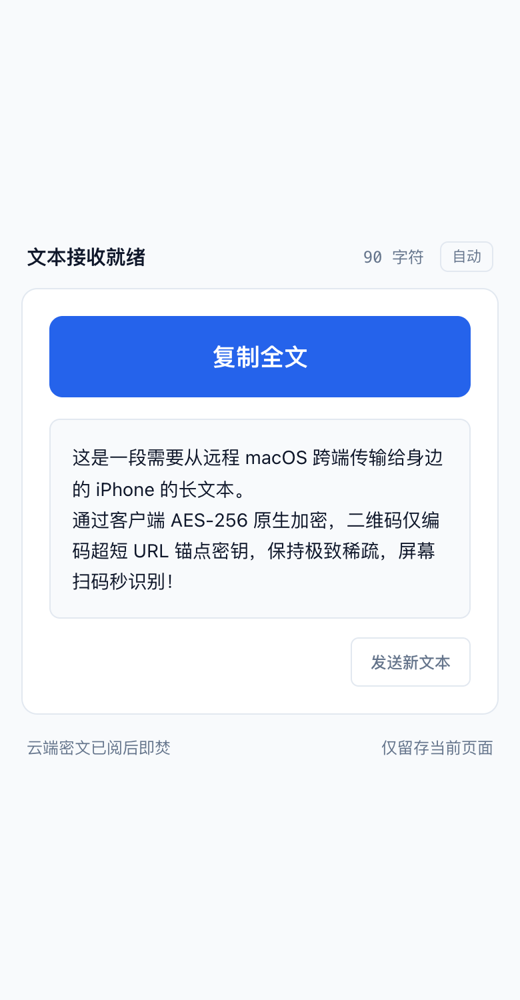

# Text Relay · 极速跨端私密长文本传输

> 解决远程控制（如 RustDesk / TeamViewer / 向日葵）下，无法便捷向手机传输大段长文本的痛点。
> 纯客户端端到端 AES-256 加密 · 云端 5 分钟阅后即焚 · 二维码永远超稀疏极速识别。

---

## 界面预览

| 发送端（桌面 / 夜间模式） | 接收端（iPhone 扫码 / 日间模式） |
| :---: | :---: |
|  |  |

---

## 解决的痛点

1. **远程控制剪贴板同步受限**：通过远程桌面控制家中/公司电脑时，大段长文本（数千到数万字）经常遭遇剪贴板截断或丢格式。
2. **长文本二维码浓稠无法扫描**：传统方案将长文本直接塞入二维码，点阵密如黑墨，手机隔着远程推流屏幕（有摩尔纹和画质损耗）完全无法对焦识别。
3. **第三方平台留痕隐患**：公共剪贴板或即时通讯工具存在数据审计、内容收集或账号关联泄露风险。

## 核心设计与功能

- **智能设备模式自适应**：
  - 加载时结合 `navigator.userAgent` 与触控指针特征自动判定当前环境，桌面端默认聚焦“发送”功能，手机端默认聚焦“提取/扫码”功能。
  - 顶部提供一键手动切换按钮（桌面端 / 手机端），通过 `localStorage` 状态持久化记忆。
- **文本传输：超稀疏二维码 + 端到端零知识加密**：
  - 文本在本地浏览器通过原生 Web Crypto API（AES-256-GCM）加密。
  - 解密密钥保存在 URL 的 Hash 锚点（`#`）中，HTTP 规范保证 Hash 绝不上报服务器。
  - 二维码仅编码 50 字节短 ID，无论文本多长均保持超稀疏大格点，极易被手机摄像头识别。云端密文在手机拉取后立即物理销毁（或 5 分钟硬过期）。
- **文件传输：动态二维码连续轮播（纯前端 0 服务器）**：
  - 桌面端直接本地选取文件（限制 5MB 内），按适合手机扫码对焦的密度切分为数据分片（带序号、传输唯一标识、总帧数及 Base64 载荷）。
  - 页面以 4 帧/秒循环播放分片二维码，支持随时暂停、继续播放或取消。
  - 手机端直接调取摄像头视频流，通过轻量级 `jsQR` 实时解析帧并自动去重；采用“分片编号 + 循环播放”优雅解决漏帧补齐问题，收齐后按原二进制字节重组并一键下载。
  - 纯本地运行：文件数据完全不经过后端服务器，0 云端留痕。
- **自适应系统外观**：原生支持日间（Light）/ 夜间（Dark）自适应跟随与手动循环切换。

---

## 多平台部署指南

本项目核心仅依赖：**静态 Web 托管 + 简单的键值临时存储（KV / Redis）**。以下为主流平台的部署方式：

### 方案一：Cloudflare Workers + KV（官方推荐 · 零成本）

最纯粹的原生支持方案，免费额度极高，全球 Edge 边缘网络毫秒级响应。

1. **克隆代码与安装依赖**：
   ```bash
   git clone https://github.com/hayoial/text-qr-transfer.git
   cd text-qr-transfer
   npm install
   ```
2. **创建 KV 命名空间**：
   ```bash
   npx wrangler kv namespace create TEXT_KV
   ```
3. **配置与发布**：
   ```bash
   cp wrangler.example.toml wrangler.toml
   # 将上面生成的 KV ID 填入 wrangler.toml
   npm run deploy
   ```

---

### 方案二：Vercel + Upstash Redis（一键无服务器部署）

适合习惯 Vercel 开发者工作流的用户。配合 Upstash Redis 实现带 TTL 的阅后即焚存储。

1. **配置环境变量**：
   在 Vercel 控制台创建项目，在 Storage 中添加 **Upstash Redis**，自动注入以下环境变量：
   - `KV_REST_API_URL`
   - `KV_REST_API_TOKEN`
2. **API 路由适配**：
   - 静态页面放入 `/public`；
   - 新建 `/api/store.js` 与 `/api/get.js`，通过 `@upstash/redis` 调用 `redis.set(id, cipherText, { ex: 300 })` 与 `redis.getdel(id)`。
3. **部署**：
   直接通过 GitHub 关联仓库或运行 `vercel deploy`。

---

### 方案三：Deno Deploy / Netlify Functions

- **Deno Deploy**：原生内置 **Deno KV**，支持通过标准 `Deno.openKv()` 写入 `{ expireIn: 300000 }`，单文件直接运行，无需依赖外部数据库。
- **Netlify**：结合 Netlify Blobs 或 Redis 插件，部署模式与 Vercel 类似。

---

### 方案四：自建 Docker / 独立 VPS（Node.js + Redis）

如果希望 100% 部署在自己的内网或私人云服务器上：

```bash
# 架构：任意极简 Node.js/Fastify/Go 静态服务 + Redis
# 核心接口逻辑：
POST /api/store  -> redis.setex(id, 300, cipherText)
GET  /api/get/:id -> redis.get(id) 并 redis.del(id)
```

---

## 本地开发调试

```bash
# 启动本地模拟 Workers + 本地模拟 KV
npm run dev
```

本地启动后访问控制台输出的本地端口即可进行开发与样式微调。

---

## 协议

[MIT License](LICENSE)
